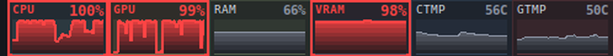

# PulseBar

GPU・CPU・メモリ・VRAM の使用率、電力、温度をコンパクトに監視できるデスクトップガジェット。



## 動作環境 (確認済み)
- OS: Linux Mint 22.3 (Zena)、デスクトップ Cinnamon 6.6.9 (X11 セッション)
- Python: 3.12.3（`python3-tk` 3.12.3 同梱の Tk 8.6 使用）。venv は `uv venv` 作成
- Python パッケージ（uv で解決済み）:
  - psutil 7.2.2（CPU/RAM/温度センサー）
  - nvidia-ml-py 13.615.71（`pynvml` として import。GPU 使用率・VRAM・電力・温度）
  - python-xlib 0.33（ウィンドウ操作。ガジェット積層の再主張）
- NVIDIA ドライバ（NVML 動作版）+ 専用GPU（NVML の無い環境では GPU 系項目が自動で選択不可）
- CPU電力(CPWR): RAPL/powercap（Intel RAPL または AMD amd_atl）


## インストール / 起動

```bash
cd PulseBar
./run.sh          # .venv が無ければ uv が自動作成（python3.12 + 依存3つ）
```

CPU電力 (CPWR) は、`run.sh` が起動時に「RAPL が存在するのに読み取れない」状態を
検出した時だけ `enable_cpu_power.sh` を自動で実行します（初回のみ、認証を聞か
れます）。手動でやる場合:

```bash
sudo ./enable_cpu_power.sh
```

（RAPL の energy_uj を読みます。読めない環境では CPWR は自動で選択不可になります）


## 表示

- 監視項目（既定順）: 
  - CPU
  - GPU
  - RAM
  - VRAM
  - CPU電力(CPWR)
  - GPU電力(GPWR)
  - CPU温度(CTMP)
  - GPU温度(GTMP)
  - GPUファン(FAN)
  - CPU周波数(CFRG)
  - ネット(NET)
  - ディスクI/O(DISK)
  - SSD温度(STMP)
  - 追加5項目(FAN/CFRG/NET/DISK/STMP)は既定 off。config.json の items で on にする
  - CFRG(MHz, 下限1000)/NET・DISK(MB/s, 下限10) は GPU電力と同じ自動スケール。NET/DISK は >=1000 MB/s で '1.2G' と GB/s 繰り上げ
- 各項目は「波形 + 現在値」の横並び
  - 数値: 今の値を正確に認識するため
  - 波形: 過去からの推移を直感的に理解するため（表示範囲は約 1 分）
- 左ドラッグ: ドック時・ガジェット上段プレス時はバー裏の最前面ウィンドウ（Chrome/Nemo 等）を一緒に動かし、ガジェット波形帯領域プレス時はバー自身を動かす（対象がなければ従来動作）
- 中クリック: バー下の窓を前面へ巡回（重なった窓の選択）
