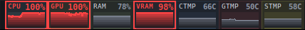

# PulseBar

A compact resident system monitor bar for Linux (X11): a light always-on bar with a wide choice of items — CPU, GPU, RAM, VRAM, CPU/GPU power, CPU/GPU/SSD temps, fan, frequency, net, disk — each cell shown or hidden from the right-click menu. Drops into the Linux Mint Cinnamon panel, or floats as a desktop widget.




## Requirements (tested)
- OS: Linux Mint 22.3 (Zena), Cinnamon 6.6.9 (X11). Linux (X11) only; no Windows / Wayland
- Python: 3.12.3 (Tk 8.6 from `python3-tk`), venv created by `uv`
- Python packages: psutil 7.2.2, nvidia-ml-py 13.615.71 (`pynvml`), python-xlib 0.33
- NVIDIA driver with NVML + dedicated GPU (no NVML -> GPU metrics auto-disabled)
- CPU power (CPWR): RAPL/powercap (Intel RAPL or AMD amd_atl)

## Install / Run

```bash
cd PulseBar
./run.sh    # auto-creates ./.venv with uv if missing
```

CPWR: `run.sh` runs `enable_cpu_power.sh` automatically only when RAPL exists
but is unreadable (first run, asks authorization). Manual: `sudo ./enable_cpu_power.sh`

## Display

- Metrics (grouped order): CPU LOAD CFRG CPWR CTMP / GPU GCLK GPWR GTMP FAN /
  RAM MTMP VRAM / NET DISK STMP
  - CFRG/CPWR/FAN/NET/DISK/STMP/GCLK/LOAD/MTMP default off; enable in `items`
    of config.json or from the right-click menu
  - GCLK = GPU SM clock (GHz, '2.9G'), LOAD = CPU load average (1 min),
    MTMP = DIMM (memory module) temperature (°C)
  - CFRG/GCLK display in GHz ('2.9G'); NET/DISK (MB/s, floor 10) autoscale
    like GPU power; NET/DISK show '1.2G' at >=1000 MB/s
- Each cell: "waveform + current value" (waveform window ~1 min, gradient fill)
- High load auto-highlighted: warning=orange, critical=red (thresholds: top of PulseBar.py)

## Operation

- Right-click: menu (Layout: Dock/Gadget, Always on top, orientation; Show/Hide: toggle items; Quit)
- Left-drag waveform: move gadget (gadget mode; saved in `geometry`)
- Esc: quit. Externally: `kill -USR1 <pid>` toggles dock/gadget

## Configuration (config.json)

Edit config.json and restart.

| Key | Meaning |
|---|---|
| mode | `gadget` / `dock` (embedded in bottom panel band, same height) |
| items | metric key -> true/false |
| order | cell order |
| topmost | true = always on top / false = normal stacking |
| orient | `h` / `v` (gadget only) |
| geometry | gadget position [x, y] |
| dock_auto | true (default): x auto-placed left of tray; false: use dock_offset_x |
| dock_offset_x | dock x offset px (when dock_auto=false) |
| dock_height | dock height; 0 = auto (band height, min 34) |

Full spec: docstring at the top of PulseBar.py.
